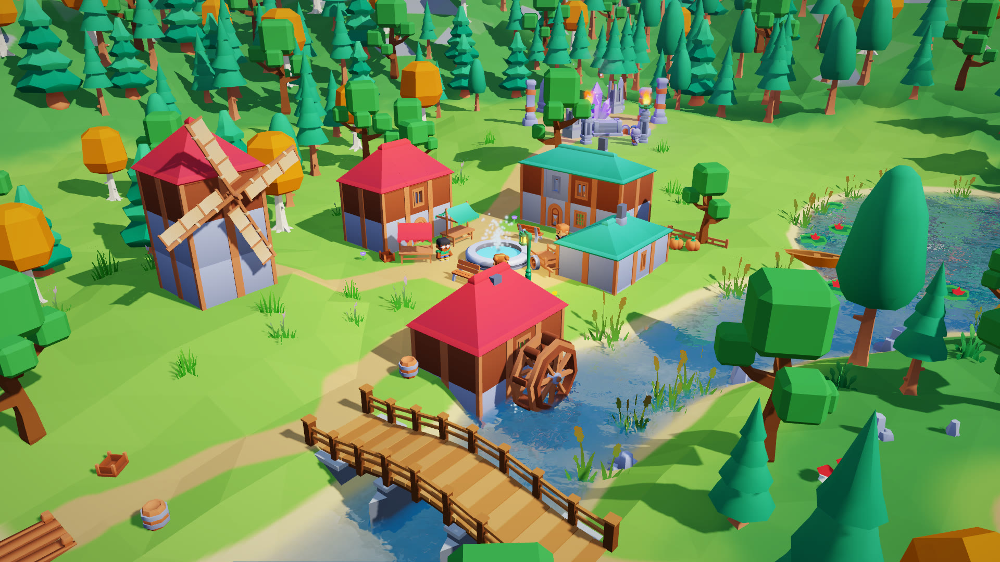
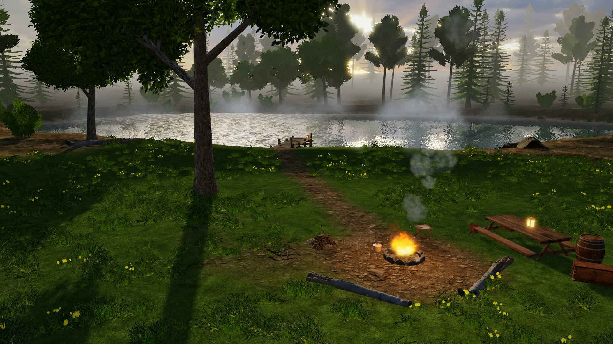

# Engine3D

Engine3D is a 3D engine written in Java with LWJGL 2 and OpenGL. It renders terrain with blended, normal-mapped textures, reflective water, sun shadows, fog, a skybox, foliage that moves in the wind, and particle effects. Each frame then gets 4x MSAA, HDR tone mapping and bloom. A built-in editor lets you change entities while the scene runs. The repository comes with two demo scenes: a low-poly lakeside village and a realistic forest clearing.





## Setup

You need Windows (the bundled LWJGL natives are Windows DLLs) and JDK 20 or newer on your `PATH`.

```powershell
git clone https://github.com/ItsMeShane/Engine3D.git
cd Engine3D
.\run_village.ps1    # or .\run_forest.ps1
```

The scripts compile `src/` into `out/run` and start the chosen scene. If PowerShell refuses to run scripts, use `powershell -ExecutionPolicy Bypass -File .\run_village.ps1`.

To run it from IntelliJ IDEA instead, open the folder and run `engineTester.MainGameLoop` with the VM option `-Djava.library.path=libs/natives` and `village` or `forest` as the program argument.
